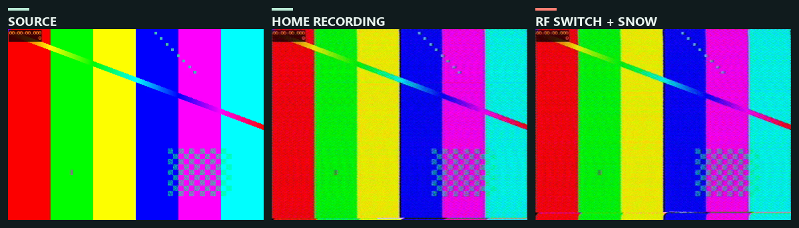

<p align="center"></p>

# PAL VHS · Cassette Edition

A PAL 625/50 composite and VHS signal simulator for Windows and Android. Tune the tape and playback deck, preview the changes, then export the clip.

[Windows build](docs/BUILD_AND_PUBLISH.md#windows-desktop) ·
[Android build](docs/BUILD_AND_PUBLISH.md#android-local-build) ·
[GitHub setup and releases](docs/BUILD_AND_PUBLISH.md#publish-the-repository) ·
[Reproducible examples](examples/README.md)



*One synthetic frame, processed at 2× RF sampling. The third panel exaggerates the head-switch snow so it is easy to find.*

## Use the app

| | Windows | Android |
| --- | --- | --- |
| **Start** | Open a clip, pick a tape preset, and apply it. | Choose a video and select a tape preset. |
| **Preview** | Scrub, step, or play. Signal scopes display composite and tape stages. | Scrub, step, or press Play. Processed frames appear as they finish. |
| **Tune** | Easy offers tape macros and deck profiles. Advanced groups individual settings. | Use the tape macros or turn on Advanced settings and pick a group. |
| **Export** | FFmpeg writes 720×576 at 25 fps. Woven and single-field output are available. | A 720×576 H.264 MP4 lands in `Movies/PAL-VHS/`. Source AAC is copied when present. |

Advanced controls on both platforms follow the same Rust visibility rules. Choose **RF switch**, **legacy overlay**, or **off** under **Head switching**. Enable RF snow and turn on **Snow follows head-switch line** to anchor the snow to the switch in each field.

### What runs under the hood

One sampled Rust engine models the PAL composite encoder, VHS luma FM and colour-under paths, tape damage, TV sync recovery, and colour decoding. The normal sample rate is 17.734375 MHz. Choose `2x` RF sampling for the highest available RF resolution. Temporal field sampling takes the second field 20 ms later. Both previews use the same signal engine as their exports.

A full signal render can take longer than a frame interval. Android playback advances as frames finish. Windows preview can skip late frames during playback. Codec support and speed depend on the device and source.

## Project layout

```text
.
├── .github/workflows/     GitHub build and artifact automation
├── android/
│   ├── app/               Kotlin UI, MediaCodec and adaptive launcher icon
│   └── rust/              JNI bridge into the shared Rust engine
├── assets/
│   ├── icons/             Windows icon and shared artwork
│   └── *.json             Controls, tape presets, decks and macros
├── docs/                  Build, publishing and validation notes
├── examples/              Sample settings and reproducible comparison
├── reference/             Original Python reference and historical material
├── src/
│   ├── signal/            PAL, VHS and tape-damage processing
│   ├── gui.rs             Windows desktop controls and signal scopes
│   └── mobile.rs          Android frame fitting and rendering sessions
├── tests/                 Signal fixtures, media and control regressions
└── tools/                 Icon generation and Windows runtime packaging helpers
```

## Build and verify

For a Windows release, extract the ZIP and double-click **Launch PAL VHS.cmd**. Keep the `app/` folder beside the launcher.

Follow the [step-by-step build and GitHub guide](docs/BUILD_AND_PUBLISH.md) to build the Windows app, produce an Android APK locally or in GitHub Actions, and attach both packages to a release.

To run the engine tests without GStreamer, install Rust and put FFmpeg and FFprobe on `PATH` for the media tests.

```sh
cargo test --locked --no-default-features --release
```

For exact CLI examples, see [examples](examples/README.md). For the numerical reference comparisons, see [validation](docs/VALIDATION.md).
